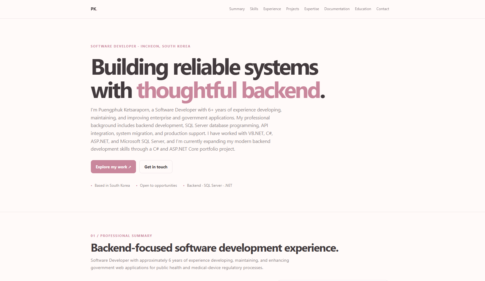

# Puengphuk Ketsaraporn — Software Developer Portfolio

A personal portfolio website showcasing my professional experience, technical skills, selected projects, and software development background.

**Live Portfolio:** [https://ketsrp2112.github.io/portfolio/]

## Portfolio Preview



## About

I am a Software Developer with 6+ years of experience in developing, maintaining, and improving enterprise and government web applications.

My professional experience focuses on backend development, Microsoft SQL Server, database programming, API integration, system migration, and production support.

This portfolio presents my professional background and demonstrates my ongoing development of modern backend applications using C# and ASP.NET Core.

## Portfolio Sections

The website includes the following sections:

- **Professional Summary** — Overview of my background and development experience.
- **Technical Skills** — Backend, database, API integration, frontend, and development tools.
- **Professional Experience** — Employment history, responsibilities, and career progression.
- **Selected Projects** — Personal and professional project highlights.
- **Technical Expertise** — Case studies covering database development, SQL troubleshooting, API integration, system migration, and production support.
- **Project Documentation** — System architecture, business workflow, database design, API documentation, and user manual.
- **Education & Languages** — Educational background and language proficiency.
- **Contact** — Contact information, GitHub, LinkedIn, and resume links.

## Featured Project

### License Management System

A web-based application for managing medical-device establishment license requests, covering application submission, officer review, revision requests, approval, and PDF certificate generation.

**Key Features**
- Trader and Staff workflows
- Application types: New License, Amendment, Renewal, and Cancellation
- Application status management and history tracking
- Supporting document uploads
- PDF certificate generation
- RESTful API integration

**Technology Stack**
- C#
- .NET 10
- ASP.NET Core Web API
- Entity Framework Core
- Microsoft SQL Server
- HTML, CSS, and JavaScript

## Technology Stack

| Category | Technologies |
|---|---|
| Backend | VB.NET, C#, ASP.NET, ASP.NET Core Web API |
| Database | Microsoft SQL Server, T-SQL, Stored Procedures |
| API & Integration | REST API, SOAP, JSON, XML |
| Frontend | HTML5, CSS3, JavaScript, AngularJS |
| Tools | Visual Studio, VS Code, SSMS, Git, GitHub |
| Framework | Entity Framework Core, .NET 10 |

## Built With

This portfolio website is built using:

- HTML5 — Semantic page structure
- CSS3 — Responsive layout and visual styling
- JavaScript — Interactive navigation and dynamic copyright year

No frontend framework is required.

## Project Structure

```text
Portfolio/
│
├── index.html
├── README.md
│
├── images/
│   └── License/
│       ├── LC_Staff_list.png
│       ├── LC_Staff_detail.png
│       ├── LC_flow_his.png
│       └── LC_Swagger.png
│
├── docs/
│   ├── System_Architecture.pdf
│   ├── Business_Workflow.pdf
│   ├── Database_Design.pdf
│   ├── API_Documentation.pdf
│   └── User_Manual.pdf
│
└── resume/
    ├── RESUME_ENG.pdf
    └── RESUME_KOR.pdf
```

## Run Locally

1. Clone the repository:

   ```bash
   git clone https://github.com/ketsrp2112/Portfolio.git
   ```

2. Open the project folder.

3. Open `index.html` in your browser.

Alternatively, use the Live Server extension in Visual Studio Code.

## Deployment

The portfolio can be hosted using GitHub Pages.

Once GitHub Pages is configured, the website is accessible through the public portfolio URL.

## Contact

- **GitHub:** https://github.com/ketsrp2112
- **LinkedIn:** https://www.linkedin.com/in/ketsaraporn-puengphuk/
- **Email:** ketsrp.21@gmail.com

---

© Puengphuk Ketsaraporn. All rights reserved.
